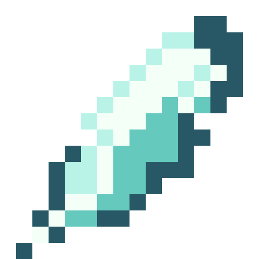

<p align="center">
  
</p>

<h1 align="center">F3ather</h1>

<p align="center">A lightweight, customizable F3 debug overlay for Minecraft.</p>

<p align="center">
  <a href="https://github.com/Hachimi2333/F3ather/releases">Releases</a> ·
  <a href="https://github.com/Hachimi2333/F3ather/issues">Issues</a> ·
  <a href="README.zh-CN.md">简体中文</a>
</p>

## Features

- Switch between **Simple**, **Performance**, **World**, **Mods**, and **Vanilla**. The Mods tab appears when another mod adds debug lines, including recognized Sodium statistics.
- Create custom tabs with searchable debug entries and a drag-and-drop preview for all four screen corners.
- Keep Minecraft's font, per-line backgrounds, debug charts, and server-enforced reduced debug information. F3ather caches glyph drawing instructions and samples debug data at a configurable rate.
- Choose **1 Hz**, **5 Hz**, **10 Hz**, **20 Hz**, or **Unlimited**. The default is 10 Hz, while Unlimited samples every frame.
- Let the tab bar auto-hide after four seconds or hide it permanently. Settings also include an animation toggle and a Compatibility Mode that restores vanilla F3 behavior.

## Installation

F3ather runs on the client with **Minecraft 1.21.1**, **NeoForge 21.1.172 or later in the 21.1 series**, and **Java 21**.

1. Download the JAR from [Releases](https://github.com/Hachimi2333/F3ather/releases).
2. Place it in your Minecraft instance's `mods` folder and launch the NeoForge profile.

OpenUI MC is bundled in the JAR as a dependency for the settings screen.

## Controls

| Shortcut | Action |
| --- | --- |
| `F3` | Open or close the debug overlay |
| `Tab` while F3 is open | Switch to the next enabled tab, including when the tab bar is hidden |
| `F3 + Page Up` / `F3 + Page Down` | Change pages on long Mods or custom tabs |
| `F3 + 1` / `F3 + 2` / `F3 + 3` | Toggle the native debug charts |
| `F3 + 0` | Open F3ather settings |
| `/` in the tab editor | Search for a debug entry to add |

You can also open settings from **Mods → F3ather → Config**. Custom tab layouts and preferences save automatically to `config/f3ather-tabs.toml`.

## Build from source

Set `JAVA_HOME` to a local JDK 21 and use the Gradle Wrapper. The default build uses NeoForge 21.1.267.

```sh
./gradlew build
./gradlew runClient
```

On Windows, use `.\gradlew.bat` in place of `./gradlew`. The build writes the JAR to `build/libs/`. Add `-PneoVersion=21.1.172` to build or run against the minimum supported NeoForge version.

The build verifies the bundled OpenUI MC 0.0.16 checksum. Gradle and Maven Central mirrors are enabled by default. Use `-PuseChinaMirrors=false` to turn them off. NeoForge artifacts come from the official repository.

### Testing

```sh
./gradlew build fixtureClasses fixturePeerClasses
./gradlew -PneoVersion=21.1.172 build fixtureClasses fixturePeerClasses
./gradlew runFixtureClient -PfixtureAuto
./gradlew runFixtureClient -PfixtureAuto -PfixtureVisual
./gradlew runFixtureClient -PfixtureBaseline -PfixtureAuto
```

The two fixture mods add and edit text at different points in the collection pipeline. Automatic runs log sampling and timing through `F3ATHER_MEASUREMENT` in the fixture instance's `logs/latest.log`. Visual runs save screenshots of the HUD, settings, and editor.

For the multiplayer fixture, start the loopback host first. Once it is ready, launch the guest in a separate terminal.

```sh
./gradlew runFixtureClient -PfixtureAuto -PfixtureHost=25578
./gradlew runFixtureClient -PfixtureServer=127.0.0.1:25578
```

When checking in game on both NeoForge versions, cover F3 animations and chart shortcuts, the hidden tab bar, settings in both languages and at different GUI scales, editor input and drag-and-drop, and the Mods tab with and without Sodium.

## Contributing

See [AGENTS.md](AGENTS.md) for repository conventions. When reporting a bug, include the Minecraft, NeoForge, and F3ather versions, reproduction steps, relevant logs, and other installed mods. [Open an issue](https://github.com/Hachimi2333/F3ather/issues).

## License

F3ather is licensed under the [MIT License](LICENSE). The bundled OpenUI MC license is included in the [third-party notices](src/main/resources/META-INF/LICENSE-OpenUI-MC.txt).
